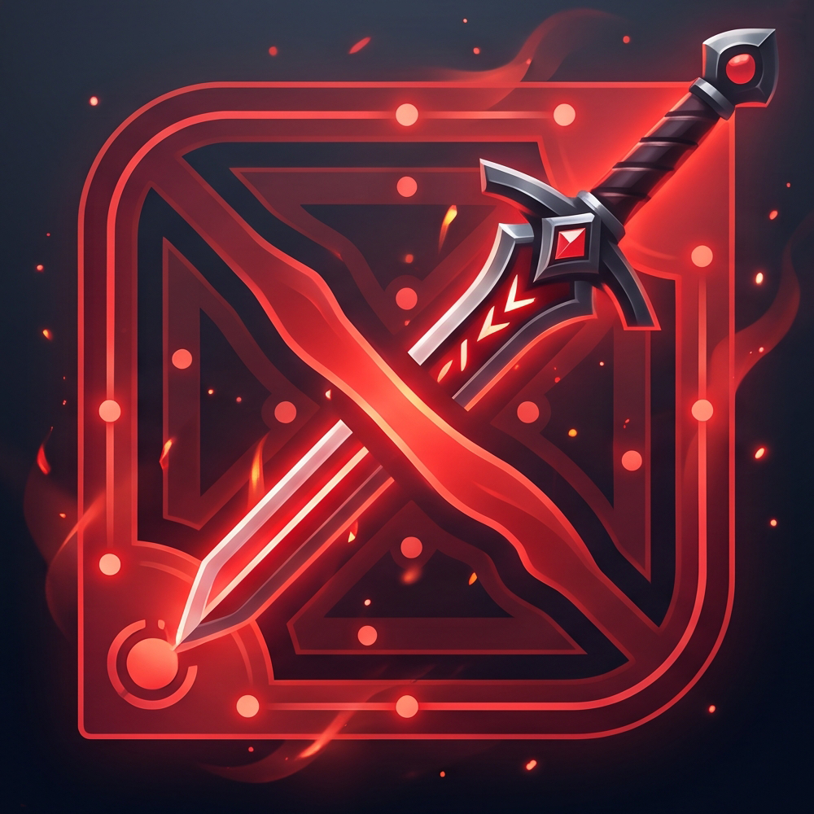
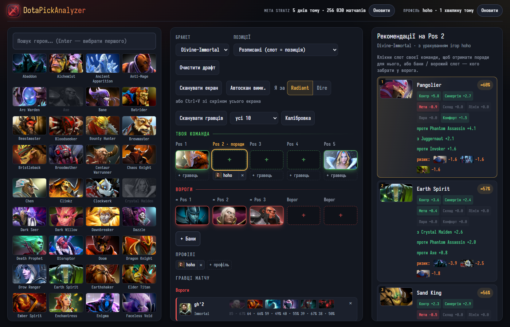
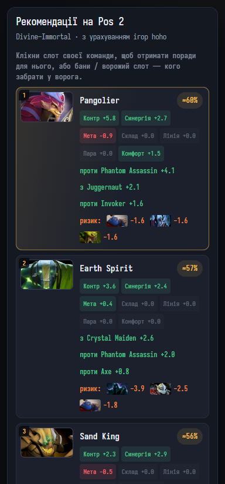
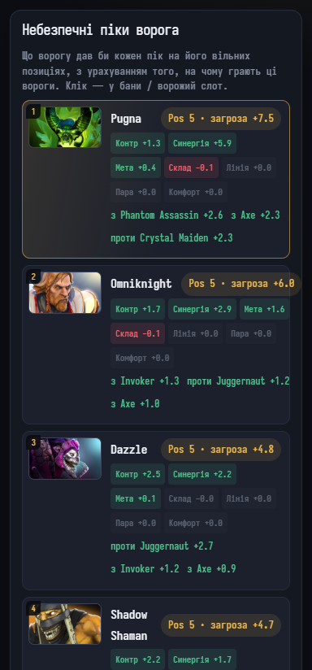
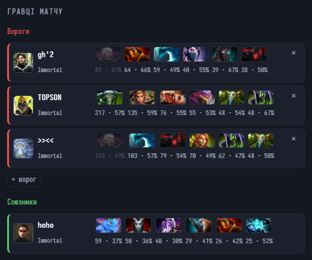
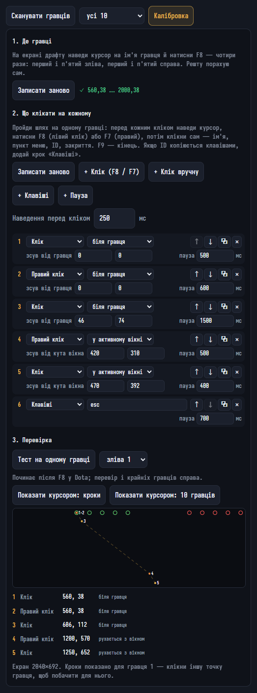

# Dota Helper

<p align="center">
  
</p>

A desktop draft assistant for Dota 2. During the pick phase it tells you which hero to take for your position, which enemy picks to ban, and what the players in your match actually play. It sits next to the game in its own window; the interface is in Ukrainian.



## What it does

### Pick recommendations

Fill in the heroes picked so far, click the slot you are picking for, and the app ranks every remaining hero for that position. Each suggestion shows where its score comes from, so you can see why it is there and not just trust a number:

| Part | What it measures |
|---|---|
| **Контр** (counter) | How the hero does against the enemy heroes already picked |
| **Синергія** (synergy) | How it plays with your allies |
| **Мета** (meta) | Its current win rate in your rank bracket |
| **Склад / Лінія / Пара** | Team composition, lane and lane-partner fit |
| **Комфорт** (comfort) | How much, and how well, the player in that slot plays the hero |

Under the chips are the strongest reasons ("against Phantom Assassin +4.1") and the main risks: enemy heroes that are still available and would hurt this pick.

<p align="center">
  
  &nbsp;&nbsp;
  
</p>

### Ban advice

Click a ban slot or an empty enemy slot and the list switches to the enemy's point of view: what each pick would give them on their open positions. When the enemy players are known, it also counts what those players are good at. One click sends a hero to the bans.

### Players of the match

Add a player by Steam ID, friend ID or a link to their Steam profile (custom links are resolved through Steam). For each one the app shows rank and most played heroes with games and win rate. Enemy heroes are one click away from a ban, and allies' profiles feed the comfort score for their slots.

<p align="center">
  
</p>

Profiles you play with often can be saved and dragged onto ally slots. When heroes and players would fit better in other positions, the app suggests the swap.

### Reading the draft from the screen

Instead of clicking heroes in by hand, paste a screenshot of the game (Print Screen, then Ctrl+V) or share the game window and turn on auto scan. The app finds the ten portraits in the top bar and fills the draft. A portrait it does not recognise, such as an arcana or a persona, can be taught by dropping the right hero on it.

### Lobby scan

Collects the Steam IDs of the ten players by clicking through their profiles in the game, the way you would by hand, and reading the ID that gets copied. Where to click is recorded once in a calibration panel:

- F8 and F7 in the game record left- and right-click points; F9 ends the recording.
- Each step can be tied to the screen, to the player's slot, or to the active window, so clicks follow a Steam window that has been moved.
- A map shows where every click will land, and a dry run moves the cursor over the points without clicking anything.

<p align="center">
  
</p>

The scan is Windows-only. It only moves the mouse and presses keys; it does not read the game's memory or files. Automating input in the game may still be against Valve's rules, so use it at your own risk. Everything else in the app works without it.

## Where the data comes from

- **[STRATZ](https://stratz.com/api)**: hero matchups, synergies and win rates per rank bracket, and players' hero statistics (the last 500 matches on each position).
- **[OpenDota](https://www.opendota.com/)**: hero list and images.
- **Steam Community**: looking up the ID behind a custom profile link.

Meta and profiles are cached in a local SQLite database (`dota-helper.db`). Players who have turned off "Expose Public Match Data" in Dota show up as closed profiles.

## Tech stack

- **Backend:** Go, [Wails v3](https://v3.wails.io/), GORM with SQLite
- **Frontend:** React 19, TypeScript, Vite, TanStack Query
- **Windows input:** Win32 through Go's `syscall` (hotkeys, cursor, clipboard)

## Getting started

### Prerequisites

- [Go](https://go.dev/) 1.26 or newer
- [Node.js](https://nodejs.org/) 18 or newer
- [Wails v3 CLI](https://v3.wails.io/) (`wails3`)
- A [STRATZ API token](https://stratz.com/api) (free)

### Setup

1. Clone the repository.

2. Install the frontend dependencies:
   ```bash
   cd frontend && npm install
   ```

3. Copy `.env.example` to `.env` in the project root and put your token in it:
   ```
   STRATZ_TOKEN=your-token
   HTTP_TIMEOUT=1m
   ```

4. Run in development mode:
   ```bash
   wails3 dev
   ```

To build the desktop app:

```bash
wails3 build
```

The header shows how old the meta is; the "Оновити" button next to it downloads a fresh one from STRATZ.

## Disclaimer

Dota 2 is a registered trademark of Valve Corporation. This project is not affiliated with or endorsed by Valve.

**Use at your own risk.** The software is provided as is, without warranty of any kind. The author is not responsible for bans, account restrictions or any other consequences of using it, including the lobby scan. Whether a tool like this is allowed is for Valve to decide, and you are the one who answers for your account.
